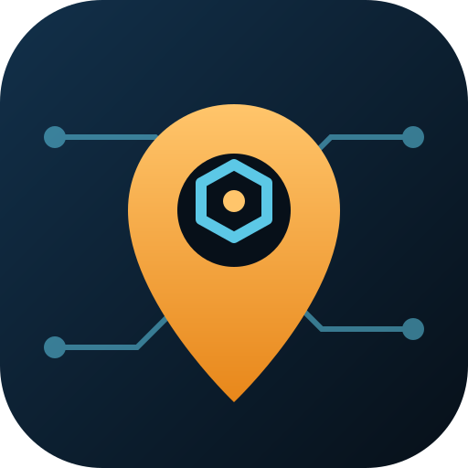
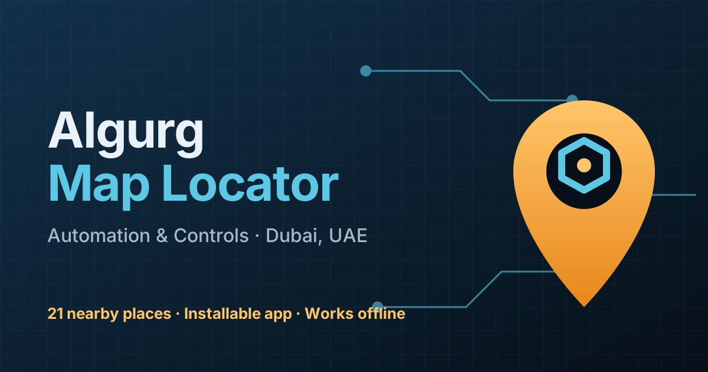
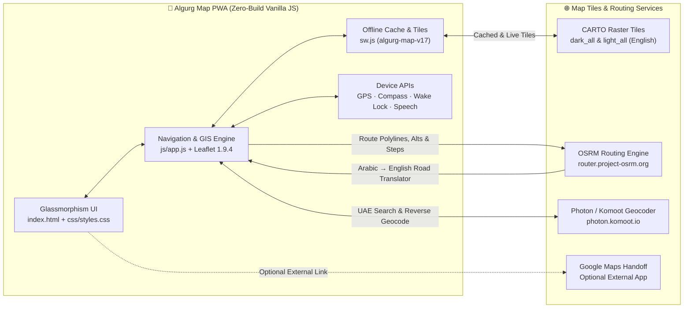
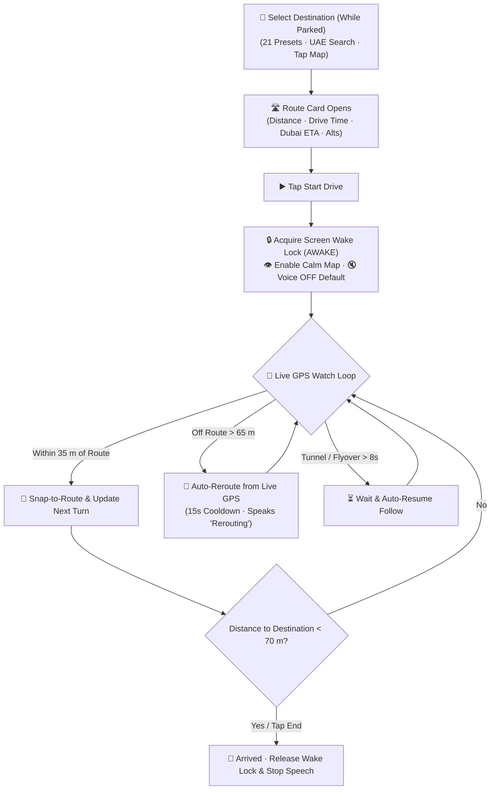

<div align="center">
  <picture>
    <source media="(prefers-color-scheme: dark)" srcset="assets/icon.svg">
    <source media="(prefers-color-scheme: light)" srcset="assets/icon.svg">
    
  </picture>

  <h1>Algurg Map Locator (PWA)</h1>

  <p>
    <strong>Mobile-First Dubai Dashboard Navigator &amp; Office Locator</strong><br>
    Reference Location: Al Gurg Automation &amp; Controls — Jebel Ali, Dubai (<code>24.9999384, 55.1300456</code>)
  </p>

  <p>
    <a href="https://githubbest729.github.io/agacmap/">
      
    </a>
    
    
    
    
    
  </p>

  <p>
    <a href="https://githubbest729.github.io/agacmap/"><strong>🚀 Open Live App</strong></a> &nbsp;&bull;&nbsp;
    <a href="#-architecture--data-flow"><strong>🗺️ Architecture</strong></a> &nbsp;&bull;&nbsp;
    <a href="#-car-mount-drive-mode"><strong>🚗 Car-Mount Mode</strong></a> &nbsp;&bull;&nbsp;
    <a href="#-project-structure"><strong>📂 Structure</strong></a> &nbsp;&bull;&nbsp;
    <a href="#-legal-safety--attribution"><strong>⚖️ Legal &amp; Safety</strong></a>
  </p>

  <br>

  
</div>

---

> [!CAUTION]
> **UAE Road Safety & Traffic Compliance:** In accordance with **UAE Federal Traffic Law**, never hold your phone or interact with the touchscreen while driving. Mount your device securely without obstructing your windshield view, configure your route *before* starting your trip, and always obey official RTA speed limits, lane markings, and road signage.

> [!NOTE]
> **Independent Utility Disclaimer:** This is an independent, unofficial navigation utility built for convenience and reference. It is not an official public product, service, or endorsement of **Easa Saleh Al Gurg Group** or **Al Gurg Automation & Controls**, and contains no confidential or proprietary corporate data.

---

## 🗺️ Architecture & Data Flow



---

## 🧱 Tech Stack

| Layer | Technology | Role in `agacmap` |
| :--- | :--- | :--- |
| **🎨 Frontend UI** | Vanilla JS (`ES2022+`) + CSS3 | Zero-framework, zero-bundler glassmorphism interface with Light/Dark themes |
| **🗺️ Map Engine** | Leaflet `1.9.4` (`vendor/leaflet/`) | Self-hosted interactive map, custom SVG pins, polylines & zero-dependency clustering |
| **🌍 Basemap Tiles** | CARTO `dark_all` & `light_all` | English-labeled OpenStreetMap raster tiles for night & day driving |
| **🛣️ Routing Engine** | OSRM (`router.project-osrm.org`) | Driving distances (`km`), estimated durations (`min`), alternative routes & turn steps |
| **🔎 UAE Search** | Photon (`photon.komoot.io`) | Dubai/UAE address autocomplete, driver POI search & tap-anywhere reverse geocoding |
| **📲 Device & PWA** | Wake Lock · Speech · Geolocation · SW | Screen-awake lock, voice guidance, heading cone & offline shell (`algurg-map-v17`) |

---

## ✨ Key Features

### 🧭 In-App Navigation & Routing
- **100% In-App Experience:** Calculates road distance (`km`), estimated driving duration (`min`), and Dubai local arrival time (`Asia/Dubai` / `UTC+4`) directly inside the PWA, with optional external handoff to Google Maps.
- **3-Way Direction Switcher:** Toggle between **From Algurg HQ**, **To Algurg HQ**, and **From my GPS** on any route.
- **Alternative Highway Routes:** Displays selectable alternate routes (e.g., `E11` vs. `E311`) when available and provides collapsible turn-by-turn directions with inline SVG maneuver icons.
- **Shareable Deep Links:** Copy direct route URLs (`?place=...` or `?dest=...`) that open straight to the active route.

### 🚗 Car-Mount Drive Mode
- **Screen Wake Lock (`AWAKE`):** Keeps the phone display awake automatically while Drive mode is active and releases when navigation ends or the browser tab is hidden.
- **Glanceable Dashboard HUD:** Displays a `58px` maneuver icon, bold distance-to-next-turn, 2-line instruction banner, and quick controls (**Voice: OFF/ON**, **Repeat**, **Calm Map**, **To HQ**, **End**).
- **Automatic Off-Route Rerouting:** Detects when the vehicle leaves the active route (`> 65 m`) and recalculates from live GPS with a 15-second cooldown.
- **Two-Stage Voice Prompts:** Off by default; when enabled while parked, speaks upcoming turns with distance and gives an approach reminder within `110 m`, plus an on-demand **Repeat** button.
- **Mounted GPS Stability:** Snaps vehicle position and bearing to the active route polyline (`<= 35 m`), prioritizes GPS course over dashboard magnetometer noise at driving speeds, and auto-resumes following after short tunnel/flyover GPS dropouts.
- **Calm Map Mode:** Reduces background map saturation and dims unrelated pins (`opacity: 0.14`) during active navigation.

### 🇦🇪 UAE Localization, Search & Offline PWA
- **Arabic-to-English Road Translator:** Automatically translates and transliterates Arabic UAE street names from OSRM into readable English (e.g., `Sheikh Zayed Rd`, `Al Khail Rd`, `Al Asayel St`).
- **Smart Place Discovery:** 21 public Dubai locations sorted by road distance/time, category filter chips, driver quick-search chips (**Petrol**, **Parking**, **Hospital**, **Metro**, **Mosque**), and tap-anywhere map routing.
- **Zero-Dependency Marker Clustering:** Groups dense pins into interactive cluster badges and spotlights the active destination.
- **Offline-Ready PWA:** Installable on iOS and Android home screens with cached app shell files, local road-time storage, and pre-warmed Dubai/Jebel Ali map tiles.

---

## 🔄 Car-Mount Drive Mode Lifecycle



---

## 📂 Project Structure

```text
agacmap/
├── index.html                  # App shell, Drive HUD, Route Card & Places Sheet
├── sw.js                       # Service worker (algurg-map-v17) & offline tile cache
├── manifest.json               # PWA manifest & home screen metadata
├── favicon.ico                 # Browser tab icon
├── css/
│   └── styles.css              # Responsive glassmorphism theme, Calm Map & HUD styles
├── js/
│   └── app.js                  # Map, clustering, OSRM routing, wake lock & voice logic
├── vendor/
│   └── leaflet/                # Bundled Leaflet 1.9.4 JS, CSS & marker assets
├── assets/
│   ├── icon.svg                # Vector app logo & pin emblem
│   ├── og-image.jpg            # Open Graph social preview banner
│   └── fonts/                  # Local Inter variable font
└── icons/
    ├── icon-192.png            # Android / PWA home screen icon (192x192)
    ├── icon-512.png            # Splash & maskable PWA icon (512x512)
    └── apple-touch-icon.png    # iOS Add-to-Home-Screen icon
```

---

## ⚙️ Deployment & Deep Links

<details open>
<summary><strong>🚀 GitHub Pages Deployment</strong></summary>

1. Upload the root files (`index.html`, `sw.js`, `manifest.json`, `favicon.ico`, `README.md`) and subfolders (`css/`, `js/`, `vendor/`, `assets/`, `icons/`) to the root of the `agacmap` repository.
2. Go to **GitHub → Settings → Pages → Deploy from branch → `main` / `/ (root)`**.
3. Reference origin coordinates are configured via `HQ` at the top of `js/app.js` (`lat: 24.9999384, lng: 55.1300456`).
4. After deploying updates, reload the live page (or clear site storage once in DevTools) so the browser activates `algurg-map-v17`.

</details>

<details>
<summary><strong>🔗 Supported URL Query Parameters</strong></summary>

| Parameter Example | Behavior |
| :--- | :--- |
| `?place=Burj%20Khalifa&mode=from` | Opens directly to the route between the HQ pin and a preset destination (`from` or `to`) |
| `?dest=25.1972,55.2744&name=Downtown&mode=from` | Drops a custom destination pin and calculates the route immediately |
| `?view=list` | Launches the app with the **Places & Dubai Search** sheet open |
| `?hq=25.1234,55.1234` | Temporarily overrides the origin coordinates for testing |

</details>

---

## ⚖️ Legal, Safety & Attribution

- **Privacy & Location Data:** This PWA runs 100% client-side with no backend server, analytics, or user database. Device GPS coordinates are processed locally in your browser and transmitted solely to third-party routing/geocoding endpoints (**OSRM** and **Photon**) to compute routes and addresses.
- **Fair-Use API Terms:** Route calculations and UAE address lookups rely on the public OSRM (`router.project-osrm.org`) and Photon (`photon.komoot.io`) demo servers for light, non-commercial/team use, alongside **CARTO** basemap tiles subject to CARTO's terms of service. For high-traffic commercial deployment, configure a dedicated routing server and commercial tile plan.
- **Map Data Attribution:** Map data &copy; [OpenStreetMap](https://www.openstreetmap.org/copyright) contributors; Basemap styling &copy; [CARTO](https://carto.com/attributions).
